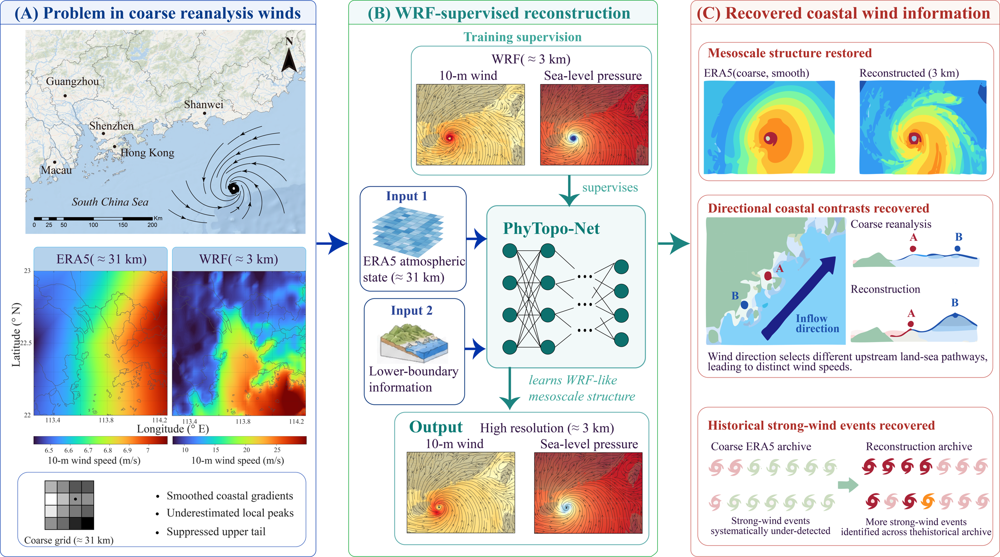
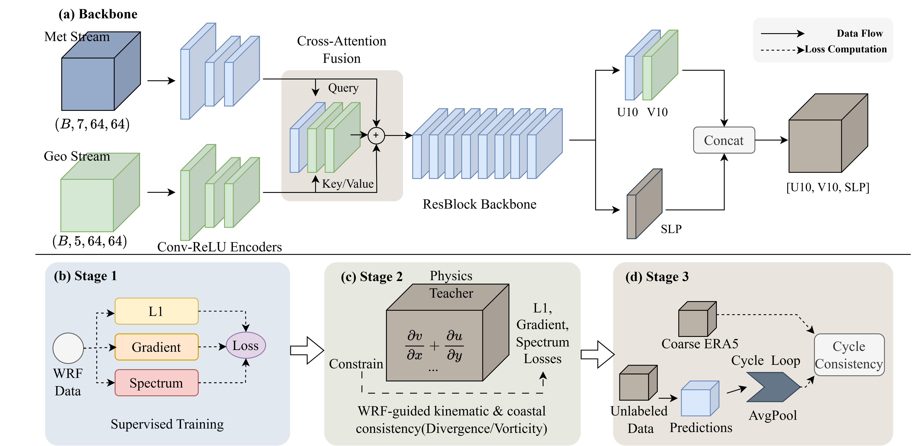
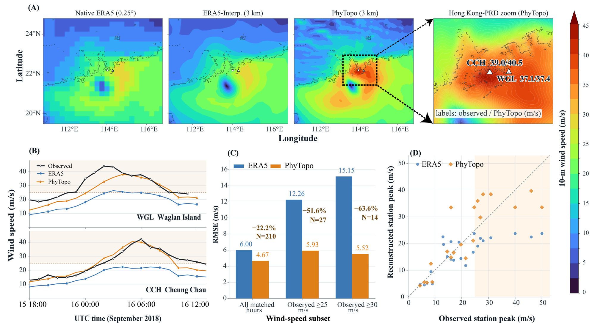
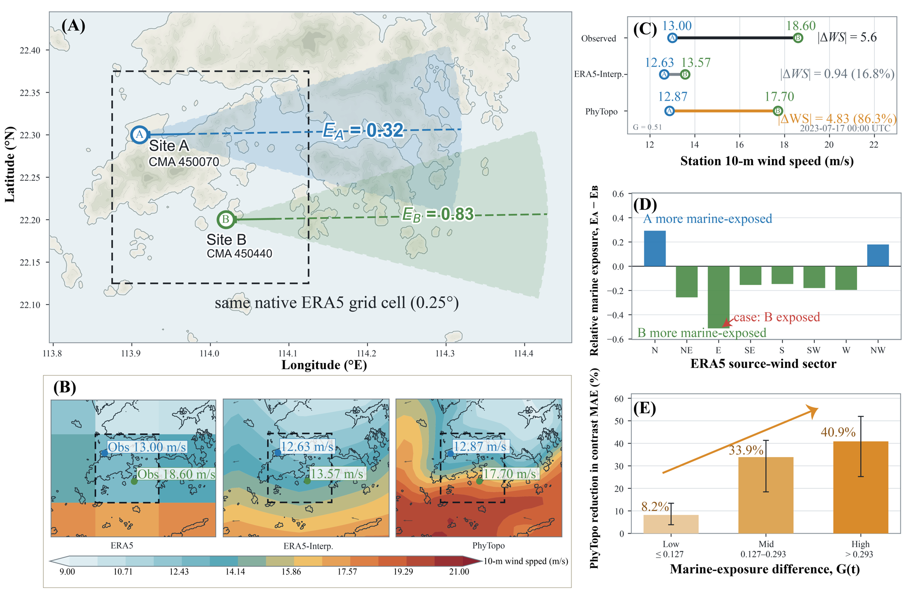
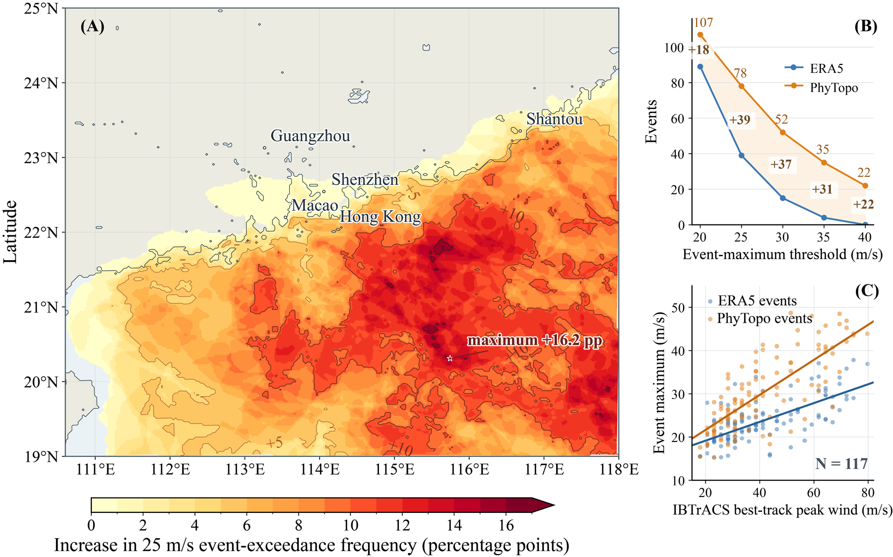

# PhyTopo-Net

**WRF-supervised reconstruction of mesoscale coastal typhoon winds from ERA5**

PhyTopo-Net reconstructs 3-km near-surface wind and pressure fields from multivariable ERA5 states and static lower-boundary information. The framework uses limited high-resolution WRF simulations as supervision, then extends the learned mesoscale structure to long historical ERA5 archives. The Greater Bay Area of southern China is used as the study domain and demonstration case.



## Network architecture and training strategy

Figure 2 from the manuscript shows the executable model and its three-stage training strategy. The backbone has separate meteorological and geographical streams, cross-attention fusion, a residual backbone, and separate wind and pressure heads. Stage 1 uses supervised WRF targets, Stage 2 adds WRF-guided kinematic and coastal-consistency losses, and Stage 3 adds cycle consistency with unlabeled ERA5 samples.



The implementation is in `model.py`, `loss.py`, `loss_physics.py`, and `train.py`; the released Stage-3 checkpoint is in `models/best_model.pth`.

## Main findings

- During Super Typhoon Mangkhut (2018), the RMSE for station observations above 30 m/s decreased from 15.15 m/s in interpolated ERA5 to 5.52 m/s after reconstruction.
- For station pairs within the same native ERA5 grid cell, the reduction in wind-contrast error increased from 8.2% under small upstream marine-exposure differences to 40.9% under large differences.
- Across 117 historical typhoons with complete paired fields, regional maximum wind speed increased in 111 events, with a median increment of 5.89 m/s. The number of events exceeding 30 m/s increased from 15 to 52.

<p align="center">
  
  
</p>



## Repository structure

| Path | Purpose |
|---|---|
| `train.py`, `model.py`, `dataset.py`, `loss*.py` | Core training implementation |
| `preprocessing/` | WRF–ERA5 paired-patch and unlabeled ERA5 preparation |
| `inference/` | Single-event, date-range, and catalogue-scale reconstruction |
| `postprocessing/` | Pressure-anchored and CMA-observation-constrained wind analysis |
| `evaluation/` | Independent-event and station-based validation workflows |
| `analysis/` | Directional-exposure and catalogue-scale analyses |
| `figures/` | Scripts used to reproduce selected manuscript figures |
| `hpc/` | SLURM examples for catalogue reconstruction and post-processing |
| `webapp/` | Self-contained Hugging Face Spaces deployment |
| `models/` | Released neural-network and post-processing parameters |
| `assets/` | Static geographical inputs used by the released model |
| `examples/` | Compact Mangkhut input examples |

The authoritative production workflow is summarized in [`docs/CODE_INVENTORY.md`](docs/CODE_INVENTORY.md). Exploratory and superseded scripts from model development are intentionally excluded.

## Installation

Python 3.10 or 3.11 is recommended.

```bash
python -m venv .venv
source .venv/bin/activate
pip install -r requirements.txt
```

Install a CUDA-enabled PyTorch build that matches the local driver when GPU inference or training is required. The web application has a separate dependency file at `webapp/requirements.txt`.

## Input data

Inference requires hourly ERA5 fields for `u10`, `v10`, `msl`, `t2m`, `sst`, `blh`, and `fsr`, together with a WRF `geo_em` file containing terrain height, land mask, latitude, and longitude. Variable aliases used in the ERA5 files are handled by `inference/predict_full_field.py`. Units, dimensions, normalization ranges, and output variables are documented in [`docs/DATA_FORMAT.md`](docs/DATA_FORMAT.md).

The repository includes:

- the final Stage-3 checkpoint at `models/best_model.pth`;
- the study-domain geographical file at `assets/geo_em.d03.nc`;
- a compact Mangkhut ERA5 example and track-pressure table in `examples/`.

A complete CPU smoke test using the bundled one-hour event is:

```bash
python inference/batch_prd130_era5_to_recon_nc.py \
  --era5-root examples \
  --out-dir outputs/quickstart \
  --device cpu --min-file-mb 0 --max-files 1 --overwrite
```

The expected output is `outputs/quickstart/Mangkhut_2018_phytopo_recon.nc` with one time step on a 459 × 549 grid. The NetCDF history attribute records the predictor settings used for the run.

## Quick start: catalogue or event reconstruction

The final production configuration uses 64 × 64 patches, a 16-grid-point stride, Hann blending, two shifted grids plus a third offset grid, and normalized-wind smoothing with sigma 0.35.

```bash
python inference/batch_prd130_era5_to_recon_nc.py \
  --era5-root /path/to/era5_events \
  --out-dir outputs/direct_reconstruction \
  --geo-file assets/geo_em.d03.nc \
  --model-path models/best_model.pth \
  --device cuda
```

Each input file must end in `_ERA5_sfc.nc`. The output contains hourly reconstructed `u10`, `v10`, and `msl` fields on the 3-km grid. CPU inference is supported with `--device cpu`.

For an arbitrary period and geographical subset:

```bash
python inference/infer_date_range_to_netcdf.py \
  --era5-dir /path/to/hourly_era5 \
  --date-start 2018-09-15 \
  --date-end 2018-09-17 \
  --lat-min 19.5 --lat-max 24.8 \
  --lon-min 110.8 --lon-max 116.8 \
  --output-nc outputs/mangkhut_reconstruction.nc
```

## Training

Training follows three stages: supervised WRF learning, physics-guided fine-tuning, and semi-supervised catalogue adaptation. Prepare paired and unlabeled patches with the scripts in `preprocessing/`, then run the final stage from the repository root:

```bash
python train.py \
  --data_dir /path/to/paired_dataset \
  --unlabeled_data_dir /path/to/unlabeled_dataset \
  --exp_name phy_topo_stage3_semisup \
  --batch_size 128 \
  --batch_size_unlabeled 128 \
  --lr 5e-6 \
  --epochs 20 \
  --w_pixel 0.5 --w_grad 0.5 --w_spec 0.1 \
  --w_cycle 0.03 --cycle_pool_size 16 \
  --resume /path/to/physics_guided/best_model.pth \
  --finetune --device cuda
```

The released checkpoint contains 838,404 trainable parameters. The exact final-stage and inference settings are recorded in `configs/` and in [`docs/REPRODUCIBILITY.md`](docs/REPRODUCIBILITY.md).

## Observation-constrained engineering product

The optional post-processing workflow applies an event-scale central-pressure anchor and then interpolates simultaneous CMA station residuals with a regularized Gaussian radial-basis function. It produces complete hourly vector wind fields while retaining the reconstructed wind direction. Run the 117-event workflow with `hpc/run_cma_analysis_117.slurm` after setting the required data paths described in that file.

CMA observations are licensed data and are not redistributed here. Reproducing the observation-constrained archive therefore requires authorized access to the hourly station data. The direct reconstruction is independent of CMA observations.

## Data, code, and online demonstration

- **Code:** this repository. A permanent GitHub URL will be added at publication.
- **Model and derived 117-event products:** [Zenodo dataset, DOI 10.5281/zenodo.23134062](https://doi.org/10.5281/zenodo.23134062).
- **Online inference:** [PhyTopo-Net Online Inference](https://huggingface.co/spaces/Shuxian/PhyTopo-Net-Online-Inference).

The Zenodo release will contain both direct reconstructions and observation-constrained hourly products, with per-event provenance and validation manifests. Source ERA5, WRF, IBTrACS, HKO, and CMA data remain governed by their original providers' terms.

## Citation

The associated manuscript is in preparation. Please cite:

Wang, S., Cai, H., Wang, Y., and Wang, J. *Recovering the suppressed upper tail of coastal typhoon winds from ERA5 using WRF-supervised reconstruction*. Manuscript in preparation.

For the released derived archive, cite:

Wang, S. et al. *PhyTopo-Net: 117-event 3-km coastal typhoon wind reconstruction archive*. Zenodo. https://doi.org/10.5281/zenodo.23134062

## License

The source code is released under the MIT License. Model weights, derived datasets, figures, and third-party source data may have separate terms; see [`docs/DATA_FORMAT.md`](docs/DATA_FORMAT.md) before redistribution.
